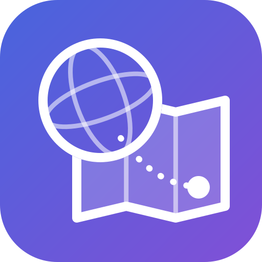
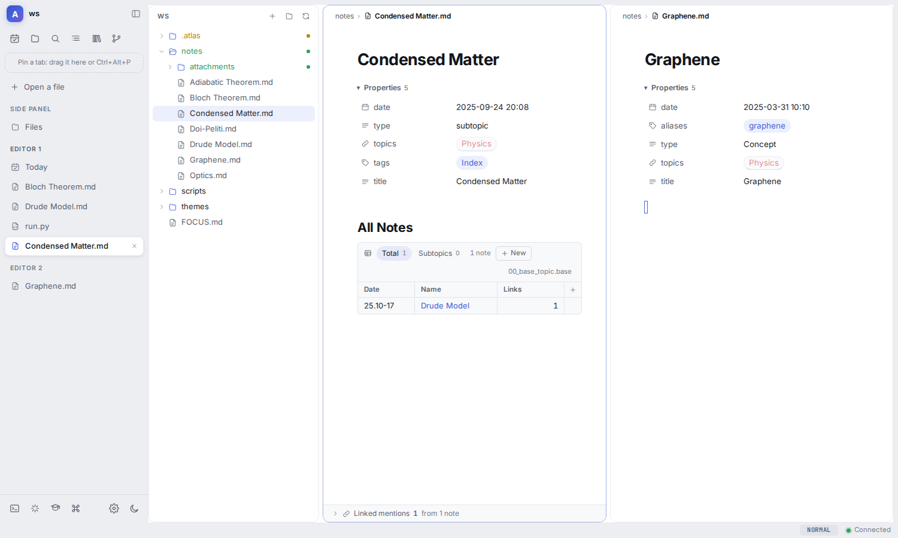

<p align="center">
  
</p>

<h1 align="center">Atlas</h1>

<p align="center">
  <b>One fast desktop workspace over plain files</b>: notes that render like Obsidian, views like Notion, papers like
  Zotero, an editor like VS Code and real terminals, all in one window, all on a folder you own.
</p>

<p align="center">
  <a href="https://github.com/alneb/atlas/actions/workflows/ci.yml"></a>
  <a href="LICENSE"></a>
  
</p>

<picture>
  <source media="(prefers-color-scheme: dark)" srcset="docs/img/vertical-tabs/after-dark.png">
  
</picture>

## Why Atlas

- **Files are the truth.** A vault is a folder of Markdown and whatever else you keep. Atlas adds one `.atlas/`
  folder of its own (settings, pages, plugins). Nothing lives only in the app, and the vault stays readable in Obsidian.
- **Everything is a file, and everything can be linked.** Things that are not Markdown (a paper, a mail, a drawing)
  get a companion note with their metadata and a block that shows them, so they can be linked with `[[wikilinks]]`,
  searched and listed like any note.
- **Fast.** A Rust core indexes the vault; the interface is never slower than the disk.
- **Yours to reshape.** Pages of blocks you arrange by hand, commands and templates in the vault, and plugins in plain
  JavaScript, reloaded on save.

## What it does

- **Notes** that render like Obsidian: live preview, wikilinks, embeds, callouts, LaTeX with snippets, Bases tables,
  tasks with priorities, dates and repeats (the Tasks plugin's format), inline expressions and templates.
- **Pages of blocks** you arrange by hand: a home screen, an inbox, a dashboard. The left bar is one too.
- **Papers**: a library with citations (`[[citekey]]`), PDFs with annotations saved into the file, notes beside the paper.
- **Code**: language servers, find and replace, formatting, problems, run and test buttons, git changes in the
  gutter, two vim modes.
- **Terminals** beside your notes, including AI coding agents that see what you are looking at (through Atlas's MCP
  server, open to any agent).
- **Capture from anywhere**: a capture box, a command bar (Super+E), a global quick-capture window, and an Android app.
- **A server mode**: serve your vaults to a browser or the phone, with a password or a sign-in proxy (Authelia,
  Authentik…) in front.
- **Plugins** for mail, calendars (CalDAV), SSH hosts, file servers, finance, books and comics, OCR and more
  ([plugin maturity](docs/guides/PLUGIN-MATURITY.md)).

## Install

**Linux packages.** Download the AppImage, `.deb`, `.rpm` or Flatpak from the
[latest release](https://github.com/alneb/atlas/releases), or build from source (below).

**Server (Docker).** Every folder in `./vaults` becomes a vault at `http://<host>:7700/v/<folder>/`:

```sh
cp .env.example .env                                   # where your vaults are, which user owns them
docker compose run --rm atlas server password          # once: set the owner's password
docker compose up -d
```

Behind a reverse proxy with a sign-in in front: [docs/guides/SERVER.md](docs/guides/SERVER.md).

**Windows and macOS** are not supported yet. The core and the browser UI are close; the desktop app needs more work
([the porting study](docs/decisions/PORTING-windows-macos.md)).

## Build from source

You need Rust (stable), Node 20+ and, on Linux, the WebKitGTK development packages Tauri asks for
(`libwebkit2gtk-4.1-dev`, `libgtk-3-dev`, `libdbus-1-dev`, `libxkbcommon-dev` on Debian and Ubuntu).

```sh
bash scripts/dev/dev.sh ~/Notes      # the core and the UI with hot reload → http://localhost:5173
bash packaging/install.sh            # build and install the desktop app and the CLI for this user
bash scripts/dev/gate.sh             # every check: secrets scan, Rust tests, lints, types, build, end-to-end
```

## Documentation

- [docs/INDEX.md](docs/INDEX.md) lists every document.
- [docs/PHILOSOPHY.md](docs/PHILOSOPHY.md): the principles every feature is checked against.
- [docs/guides/EXTENDING.md](docs/guides/EXTENDING.md): extending Atlas from inside a vault, with no change here.
- [docs/guides/PLUGIN-API.md](docs/guides/PLUGIN-API.md): writing a plugin.
- [docs/guides/DEVELOPING.md](docs/guides/DEVELOPING.md): how the app itself is changed.
- [docs/ARCHITECTURE.md](docs/ARCHITECTURE.md): the core, the API and the UI.

## Status

Atlas is young and used daily by its author. Expect rough edges, settings that still move, and plugins at different
levels of polish (`plugins/stable/` and `plugins/beta/`). Changes are listed in [docs/CHANGELOG.md](docs/CHANGELOG.md).

## Contributing

Issues and pull requests are welcome. Start with [docs/CONTRIBUTING.md](docs/CONTRIBUTING.md). AI coding agents
follow [AGENTS.md](AGENTS.md). Please report security issues privately ([docs/SECURITY.md](docs/SECURITY.md)), and
follow the [code of conduct](docs/CODE_OF_CONDUCT.md).

## License

[AGPL-3.0-or-later](LICENSE). Third-party code inside the repository keeps its own license
([docs/THIRD-PARTY.md](docs/THIRD-PARTY.md)).
