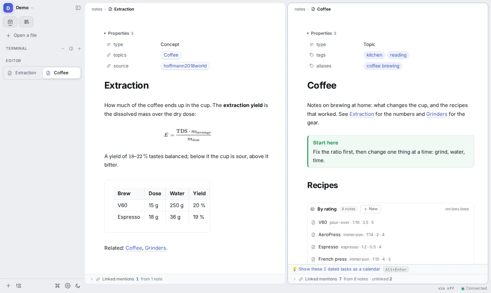

<p align="center">
  
</p>

<h1 align="center">Atlas</h1>

<p align="center">
  <b>One workspace over a folder of plain files</b>: notes that render like Obsidian, papers like Zotero, mail like
  Thunderbird, an editor like VS Code and real terminals, on the desktop, the phone, an e-ink tablet and your own
  server.
</p>

<p align="center">
  <a href="https://github.com/Alneb/atlas/actions/workflows/ci.yml"></a>
  <a href="LICENSE"></a>
  
</p>

<picture>
  <source media="(prefers-color-scheme: dark)" srcset="docs/img/readme/workspace-dark.webp">
  
</picture>

<sub>A demo vault (<code>scripts/dev/readme-shots.mjs</code> builds it and takes these shots).</sub>

## The idea in four lines

- **Everything is a file.** A vault is a folder. Notes are Markdown. Papers, mails, drawings, runs and tables are
  files too. Atlas keeps its own settings, pages and plugins in one `.atlas/` folder. Nothing lives only in a database
  or on a server, and the vault stays readable in Obsidian.
- **Everything can be linked.** Anything that is not Markdown gets a *companion note*, made for you. The note holds the
  thing's metadata as properties and a block that shows the thing itself. You link it with `[[wikilinks]]`, search it,
  tag it and list it in Bases like any note. Citing a paper is linking to its note.
- **Integrations are plugins.** Mail, calendars, the library catalogue, file servers, finance and AI agents are all
  plugins. The core stays generic: files, blocks, search, the settings form, terminals and one MCP server any agent
  can use. ([docs/PHILOSOPHY.md](docs/PHILOSOPHY.md))
- **Automation proposes, you decide.** Nothing irreversible happens without a yes, deleted things go to
  `.atlas/trash/`, and long jobs report what they are doing.

## What it does

**Writing and thinking**
- **Notes** with live preview: wikilinks, embeds, callouts, LaTeX with snippets and footnotes. Bases tables
  and cards read Obsidian's `.base` files. Tasks follow the Tasks plugin's format (priorities, dates, repeats).
  Templates and inline expressions are supported too.
- **A Today page and a daily log.** Captures land there as one line each, from any device.
- **Pages of blocks** you arrange by hand: a home screen, an inbox, a dashboard. The left bar is one too.
- **Tables**: CSV, TSV and Excel files open as a spreadsheet. You can edit cells, write formulas, filter, sort, group
  with sub-totals and plot. Named views are kept in the file's note and can be embedded anywhere
  (`![[x.csv#view=Name]]`).
- **Drawings**: Excalidraw files with their own note. On a pen tablet a stroke becomes the shape it was meant as.

**Reading and research**
- **Papers**: a library synced from Zotero, one note per paper, and citations as `[[citekey]]`.
- **PDFs** are rendered by PDFium (pdf.js stays as a backup). Highlights, underlines and ink live in the PDF's note,
  and the PDF itself is never rewritten.
- **A catalogue** of what you read, watch and listen to: books, films and series, music, anime, videos, web pages and
  papers. Each item is a note, filled in by source plugins (TMDB, Open Library, MusicBrainz, Wikipedia, YouTube,
  Letterboxd, Audiobookshelf, Linkwarden…). A pasted link is recognised and filed.
- **Books, comics and audiobooks** readers. An offline Wikipedia through kiwix-serve.

**Communication and life admin**
- **Mail**: a full client with a Rust engine (IMAP, SMTP, OAuth sign-in), three panes, and remote images blocked by
  default. The server is the store. A mail becomes a note only when you save it.
- **Calendars and contacts** over CalDAV and CardDAV, with push.
- **Finance**: a plain-text journal of your own, bank imports (OFX and others), categories and a baseline budget.
- **Notifications**: ntfy, Apprise and system notifications.

**Code and machines**
- **Code**: language servers, find and replace, formatting, problems, Run and Test buttons, git changes in the
  gutter, blame and staging, two vim modes.
- **Terminals** beside your notes. AI coding agents see what you are looking at through Atlas's MCP server, which is
  open to any agent. Plugins can offer their own tools to agents too.
- **Other machines' files in your tree**: SSH hosts and copyparty servers appear under the vault's own folders. A file
  you opened before still opens from its kept copy when the server is out of reach.
- **Web pages as tabs**, with ad blocking (Linux).

**Everywhere**
- **Capture from anywhere**: the command bar (Super+E), a global quick-capture window that opens at once, the share
  sheet and a screenshot shortcut on Android. Captures made offline are kept and sent later.
- **Server mode**: serve your vaults to a browser or the phone, with a password or a sign-in proxy (Authelia,
  Authentik…) in front.
- **Mirrors**: a vault on the laptop or the phone can mirror a vault on your server. Every device writes its own copy.
  The server hands out one writer at a time per file, so synchronisation (for example with Syncthing) never produces
  conflicts. When copies made offline do diverge, the core merges them.

## On which devices

| | |
|---|---|
| **Linux** | The desktop app (AppImage, `.deb`, `.rpm`, Flatpak) and the `atlas` CLI. |
| **macOS, Windows** | Builds come from the same workflow (`.dmg`, NSIS installer). They are not yet signed or notarized and are less tried. On Windows, plugins that need a shell use Git for Windows' `sh`. Ad blocking and web tabs are Linux-only for now. |
| **Android** | Three APKs: **Atlas** (the full app, with the core running inside it), **Atlas for Boox** (the same app, tuned for e-ink and the Boox pen) and **Atlas capture** (just the capture box). |
| **A server** | `atlas serve` or the Docker image. Every folder in `./vaults` becomes a vault. |

Each plugin states where it works, in its manifest's `[platforms]`. Settings shows why a plugin is unavailable on the
system you are on.

## How it is built

```
            ┌──────────────── the same Svelte 5 page ────────────────┐
            │  desktop window   ·   browser   ·   Android WebView     │
            └───────────────────────────┬────────────────────────────┘
                                        │ HTTP + one event stream (local key, or a sign-in on a server)
┌───────────────────────────────────────┴──────────────────────────────────────┐
│ atlas-core (Rust): the vault's files, the index and search, links and Bases, │
│ tasks, templates, git, PDFs, the mirror, the server, the MCP server, and the │
│ plugin host (settings, secrets, network permissions, scheduled tools)        │
└──────────┬──────────────────────────────────────────────┬────────────────────┘
           │ JSON over a pipe                             │ in-process
   plugin helpers (Python or Rust programs)        the desktop app (Tauri), the CLI,
   + each plugin's page side in JavaScript         the Android app (JNI), the capture box
```

- **One core everywhere.** The desktop app, the server and the Android app all run the same Rust core, and the page
  talks to it over HTTP in each case. A feature is built once and reaches every device.
- **Plugins** have a page side in plain JavaScript (`main.js`, optionally a `view.js` built from Svelte) that reloads
  when saved. They can also have a *helper*: a long-running program, either Python with only the standard library or
  a compiled Rust program, that speaks JSON over a pipe and can call the core back on that same pipe. A plugin
  declares its settings, secrets, network hosts, agent tools and schedules in `plugin.toml`. Atlas draws the settings
  page from those declarations and enforces the rest. ([docs/guides/PLUGIN-API.md](docs/guides/PLUGIN-API.md))
- **Extending without touching this repository**: commands, templates, pages, CSS snippets and plugins can all live
  in a vault's `.atlas/` folder ([docs/guides/EXTENDING.md](docs/guides/EXTENDING.md)).

### Repository map

| Path | What it is |
|---|---|
| `crates/atlas-core` | The core: files, index, API, server, mirror, plugin host, MCP |
| `crates/atlas` | The `atlas` CLI: serve, capture, run commands, open files |
| `crates/atlas-app` | The desktop window (Tauri), with the core in-process |
| `crates/atlas-android` | The Android apps: the in-app core over JNI, the native screens (Java, no Gradle), the pen notepad |
| `crates/atlas-capture` | The quick-capture box, a native window drawn on the CPU so it opens at once |
| `crates/atlas-pen` | Pen strokes to shapes, shared by the phone's notepad and the web drawing |
| `crates/atlas-template` | The template language (`{{…}}`), a superset of Obsidian's |
| `crates/atlas-text`, `crates/atlas-plugin` | Helpers shared with plugin engines, and the Rust plugin SDK |
| `ui/` | The interface: Svelte 5 + TypeScript, CodeMirror 6, dockview |
| `plugins/stable`, `plugins/beta` | The plugins, by maturity ([docs/guides/PLUGIN-MATURITY.md](docs/guides/PLUGIN-MATURITY.md)) |
| `plugins/examples` | The smallest working plugins to copy from |
| `packaging/` | Linux packages, the Docker image, the icon masters |
| `scripts/dev/` | The gate, probes, screenshots, the dev server |

## Install

**Linux packages.** Download the AppImage, `.deb`, `.rpm` or Flatpak from the
[latest release](https://github.com/Alneb/atlas/releases), or build from source (below).

**Android.** The APKs are attached to each release. They are signed with the project's key, so later versions install
as updates. ([docs/guides/ANDROID.md](docs/guides/ANDROID.md))

**Server (Docker).** Every folder in `./vaults` becomes a vault at `http://<host>:7700/v/<folder>/`:

```sh
cp .env.example .env                                   # where your vaults are, which user owns them
docker compose run --rm atlas server password          # once: set the owner's password
docker compose up -d
```

To put a sign-in proxy in front, see [docs/guides/SERVER.md](docs/guides/SERVER.md).

## Build from source

You need Rust (stable), Node 20+ and, on Linux, the WebKitGTK development packages Tauri asks for
(`libwebkit2gtk-4.1-dev`, `libgtk-3-dev`, `libdbus-1-dev`, `libxkbcommon-dev` on Debian and Ubuntu).

```sh
npm --prefix ui ci && npm --prefix ui run build   # the interface, embedded into the binaries
cargo build                                       # the core and CLI (target/debug/atlas) and the desktop app
bash scripts/dev/dev.sh ~/Notes                   # the core and the UI with hot reload → http://localhost:5173
bash packaging/install.sh                         # build and install the desktop app and the CLI for this user
bash scripts/dev/gate.sh                          # every check: secrets scan, Rust tests, lints, types, build, end-to-end
```

The end-to-end tests need Playwright's Chromium once: `npx --prefix ui playwright install chromium`. The Android
toolchain is downloaded into `local/` by `crates/atlas-android/get-toolchain.sh`, and `build-apk.sh` builds the APKs
with neither Gradle nor Android Studio.

## Documentation

| Start here | |
|---|---|
| [docs/PHILOSOPHY.md](docs/PHILOSOPHY.md) | The principles every feature is checked against |
| [docs/guides/FIRST-RUN.md](docs/guides/FIRST-RUN.md) | Opening a first vault |
| [docs/guides/KEYS.md](docs/guides/KEYS.md) | The keyboard |
| [docs/guides/EXTENDING.md](docs/guides/EXTENDING.md) | Extending Atlas from inside a vault |
| [docs/guides/PLUGIN-API.md](docs/guides/PLUGIN-API.md) | Writing a plugin |
| [docs/guides/SERVER.md](docs/guides/SERVER.md) | Running a server |
| [docs/guides/DEVELOPING.md](docs/guides/DEVELOPING.md) | How the app itself is changed |
| [docs/ARCHITECTURE.md](docs/ARCHITECTURE.md) | The core, the API and the UI |
| [docs/INDEX.md](docs/INDEX.md) | Every other document |

## Status

Atlas is young and used every day by its author, on a desktop, a phone, a Boox tablet and a home server. Expect rough
edges, settings that still move, and plugins at different levels of polish: `plugins/stable/` keeps its promises,
`plugins/beta/` may still change. Changes are listed in [docs/CHANGELOG.md](docs/CHANGELOG.md).

## Contributing

Issues and pull requests are welcome. Start with [docs/CONTRIBUTING.md](docs/CONTRIBUTING.md). AI coding agents
follow [AGENTS.md](AGENTS.md). Please report security issues privately ([docs/SECURITY.md](docs/SECURITY.md)), and
follow the [code of conduct](docs/CODE_OF_CONDUCT.md).

## License

[AGPL-3.0-or-later](LICENSE), except the plugin SDK (`crates/atlas-plugin`, `crates/atlas-core/sdk/python`), which is
MIT OR Apache-2.0 so plugins may carry any licence. Third-party code inside the repository keeps its own licence
([docs/THIRD-PARTY.md](docs/THIRD-PARTY.md)).
